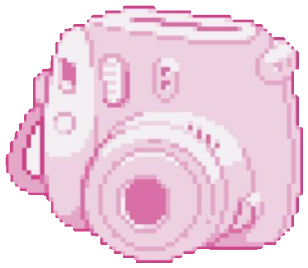
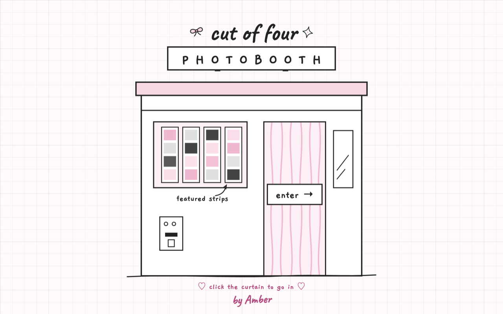

# Cut of Four 


A cute photobooth that lives in your browser. Take webcam photos, pick a pretty frame, add words and stickers, then save the final picture.



## Try it

No download or setup needed.

1. Open **[amberouyang.github.io/cut-of-four](https://amberouyang.github.io/cut-of-four/)** in Chrome or Edge on a computer.
2. Click the curtain that says **enter →**.
3. When your browser asks, click **Allow** for the camera.

## How to use it

1. Pick a filter and a frame.
2. Click **take a photo** and pose.
3. Add words and stickers on the decorate screen.
4. Click **download this frame** to save it.
5. Open **your photo shelf** to see every photo you took, and stick your favorites into **your scrapbook**.

| Do this | To do this |
| --- | --- |
| Tap a photo in the strip | Retake just that one |
| Drag a sticker | Move it on the frame |
| Scroll on a sticker | Make it bigger or smaller |
| Press undo | Bring back a photo you cleared |
| Tap **☆ feature** on the shelf | Show it in the cover featured strips |

**Tips:** Use a bright room so your photos look clear. Your photos stay on this device in your browser until you download or delete them.

## Troubleshooting

• **The camera doesn't turn on:** click the camera icon in your browser's address bar, choose **Allow**, and reload the page.

• **The page looks blank after opening the link:** wait a minute and refresh, or try Chrome or Edge on a computer.

• **Your photos disappeared:** clearing browser data removes the photo shelf. Downloads you already saved to your computer are still yours.

## Privacy

Everything runs in your browser. Your camera and photos are never recorded or uploaded unless you download and share them yourself.

## For Developers

To run Cut of Four on your own computer:

```bash
git clone https://github.com/amberouyang/cut-of-four.git
cd cut-of-four
npm install
npm run dev
```

Then open [http://localhost:5173/cut-of-four/](http://localhost:5173/cut-of-four/). Browsers only allow camera access on `localhost` or over HTTPS.

Build it with `npm run build`. Send an update to the live site with `npm run deploy`.

**Built with:** React, TypeScript, Vite, Tailwind CSS, and Google Fonts (Caveat, Gaegu, Cormorant Garamond).

**How it works:** The booth captures mirrored webcam frames in the browser, applies CSS filter presets, and places them into frame templates. Stickers and scrapbook pages are edited on the page, PNG export uses `html-to-image`, and the photo shelf is stored in IndexedDB on the visitor's device.

## Author

Amber Ouyang ([@amberouyang](https://github.com/amberouyang))
